# Himath Rajapaksha

I work where application security meets systems code — hardening how an application authenticates, authorizes and handles data, then building the tooling that watches what the kernel actually does underneath.

Currently reading for a BSc (Hons) in Cyber Security & Digital Forensics at Kingston University. **Open to remote or hybrid application security internships.**

## What I'm working on

- **Application security** — RBAC design, PostgreSQL row-level security, hardened API surfaces, and the unglamorous parts of auth that decide whether a system holds up
- **Detection engineering** — Sentinel Detection Layer (SADL): eBPF process and privilege telemetry, resolved into behavioural narratives instead of raw event spam
- **Systems & desktop** — Rust/Tauri applications, GNOME Shell extensions, and the occasional terminal emulator

## Showpiece

## Selected work

| Project | What it is |
| --- | --- |
| Sentinel Detection Layer (SADL) | eBPF (BCC) research prototype for high-fidelity process and privilege telemetry |
| [m0d](https://github.com/Himath-Rajapaksha/m0d) | Skeuomorphic desktop music player — Rust + Tauri, built for 100k+ track libraries |
| [MacTop](https://github.com/Himath-Rajapaksha/MacTop) | macOS-style global menu bar and Apple menu for the GNOME Shell top panel |
| [widgy](https://github.com/Himath-Rajapaksha/widgy) | Glassmorphic desktop widgets for GNOME Shell — clock, calendar, music, weather |
| [tommy](https://github.com/Himath-Rajapaksha/tommy) | GPU-accelerated terminal emulator in Rust with WebGPU (wgpu) rendering |
| [Cap](https://github.com/Himath-Rajapaksha/Cap) | GNOME extension that caps daily Wi-Fi usage and cuts the interface at the limit |
| [bytesmith](https://github.com/Himath-Rajapaksha/bytesmith) | Forensic design audit for AI-built UIs — 36 weighted fingerprints, PDF reports |
| [Huddl](https://github.com/Himath-Rajapaksha/Huddl) | Telehealth platform with secure video sessions, group therapy and crisis routing |

## Notes and research

- **[appsec-notes](https://github.com/Himath-Rajapaksha/appsec-notes)** — drills, CVE teardowns and lab writeups, kept short and reusable: a header audit that maps controls to bug classes, a Log4Shell teardown that ends in what I'd actually detect.

## Toolbox

`TypeScript` `Rust` `Python` `C#` `JavaScript` `PostgreSQL` `React` `Node.js` `Next.js` `Tauri` `WebRTC` `Redis` `Docker` `Linux` `eBPF` `CI/CD`

## Elsewhere

[himath.work](https://himath.work) — portfolio and project write-ups · [LinkedIn](https://www.linkedin.com/in/himath-rajapaksha/) · [himath.hr@gmail.com](mailto:himath.hr@gmail.com)

